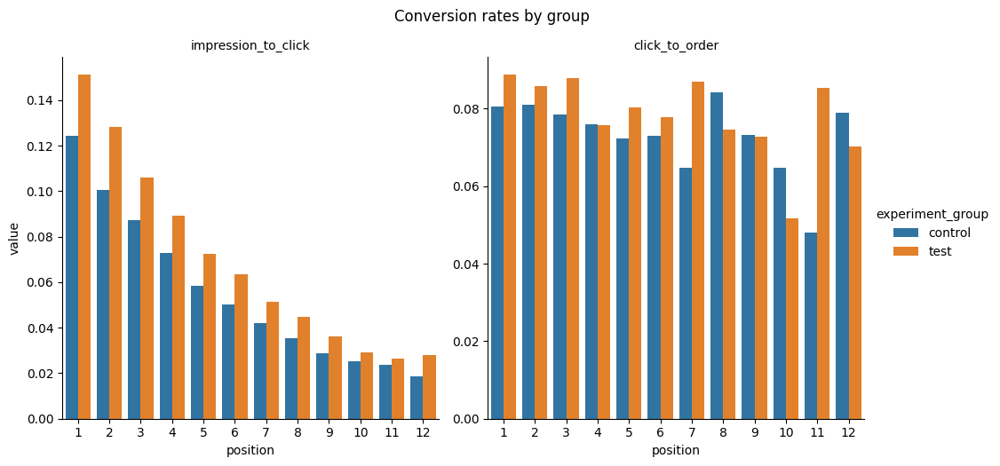
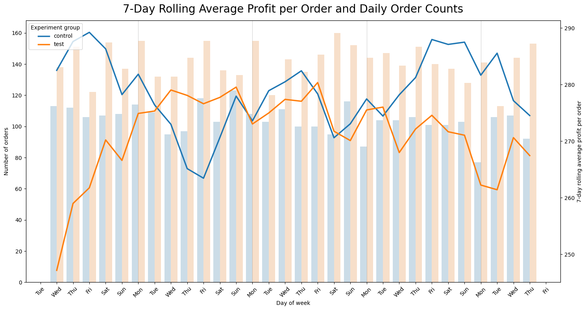
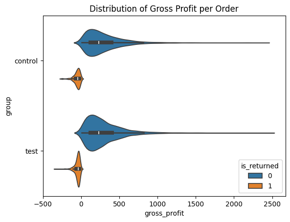

# MarketFlow — A/B-тест рекомендательной модели

[English version](README.md)

Маркетплейс тестировал новую AI-модель рекомендаций на главной странице в течение 30 дней. Задача — оценить влияние модели на вовлечённость, покупки и прибыльность и принять решение о внедрении.

**Стек:** PostgreSQL, Python, pandas, NumPy, SQLAlchemy, SciPy, Matplotlib, Seaborn.

## Что сделано

- Изучил исходные CSV-файлы, проверил типы данных и пропуски. Исключил 300 пользователей с несколькими назначениями в эксперимент.
- Спроектировал и заполнил PostgreSQL БД из 8 связанных таблиц. В анализ вошли 49 700 участников; исходные данные содержат более 1 млн показов.
- Исследовал трафик, воронку покупок, прибыльность, повторные покупки, возвраты, поддержку и категории с помощью SQL-запросов с объединениями, CTE и оконными функциями.
- Определил 7 метрик и оценил размер выборки: 23 100 пользователей на группу при alpha = 5%, мощности 95% и относительном MDE CTR 3%. Фактически — 24 674 и 25 026 пользователей.
- Проверил распределение участников 50/50: SRM-тест не выявил значимого дисбаланса (p = 0,1154).
- Собрал эффекты, доверительные интервалы и выводы по 7 метрикам в одну таблицу. Использовал t-тест Уэлча и перестановочный тест на уровне пользователей, бутстрэп-интервалы для отношений и поправку Холма для шести дополнительных метрик.

Дизайн и расчёт выборки описаны ретроспективно, на основе уже доступных данных эксперимента.

## Результаты

| Метрика | Контроль | Тест | Относительное изменение |
| --- | ---: | ---: | ---: |
| CTR | 7,64% | 9,46% | +23,84% |
| Валовая прибыль на участника, руб. | 35,06 | 46,17 | +31,68% |
| Конверсия сессии в покупку | 3,78% | 5,03% | +32,99% |
| Доля пользователей с двумя и более заказами | 0,82% | 1,64% | +99,62% |
| Конверсия перехода в карточку в покупку | 7,76% | 8,40% | +8,21% |
| Доля возвратов | 5,50% | 6,82% | +23,97% |
| Обращения по качеству на 100 заказов | 1,86 | 1,89 | +1,76% |

Первые пять метрик улучшились статистически значимо. Доля возвратов также значимо выросла (+1,32 п.п.; p с поправкой = 0,0396). Значимого изменения обращений по качеству не выявлено.

Валовая прибыль учитывает всех участников и записанный в данных эффект возвратов. Конверсия перехода в карточку в покупку — доля кликов, связанных хотя бы с одним заказом.

**Рекомендую поэтапное внедрение с мониторингом доли возвратов и валовой прибыли на пользователя.** Модель улучшает вовлечённость и краткосрочные финансовые результаты; основной компромисс — рост возвратов.

## Ключевые визуализации

**Конверсии по позиции карточки.** В тесте CTR выше на всех позициях. Справа показано отношение заказов к кликам, которое отличается от метрики конверсии, используемой в статистическом тесте.

**Количество заказов и валовая прибыль на заказ.** Рост числа заказов позволяет увеличить прибыль на пользователя даже при снижении прибыли на заказ.

**Распределение валовой прибыли на заказ.** Описательные изменения без отдельных проверок статистической значимости показывают рост продаж недорогих товаров.

## Файлы проекта и запуск

- [DB_init.ipynb](DB_init.ipynb) — изучение, подготовка данных и загрузка в БД.
- [EDA.ipynb](EDA.ipynb) — SQL-анализ, графики, дизайн и результаты A/B-теста.
- [Create_Market_Flow.sql](Create_Market_Flow.sql) и [Market_Flow.png](Market_Flow.png) — схема БД.
- [db_conn.py](db_conn.py) — функции подключения к PostgreSQL.

Для запуска нужны перечисленные Python-библиотеки, а также `psycopg2-binary`, `python-dotenv` и Jupyter. Помести в `data/` восемь CSV-файлов: `users`, `experiment_assignments`, `sessions`, `impressions`, `clicks`, `orders`, `products`, `support_tickets`. Укажи `DB_USER`, `DB_PASSWORD` и `DB_HOST` в `.env`, затем выполни `DB_init.ipynb` и `EDA.ipynb`.

Исходные CSV в репозиторий не включены. Инициализация пересоздаёт схему `public` в `market_flow`; для проекта нужна отдельная БД.
